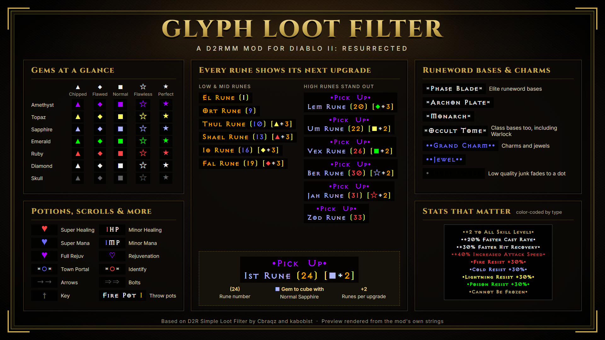
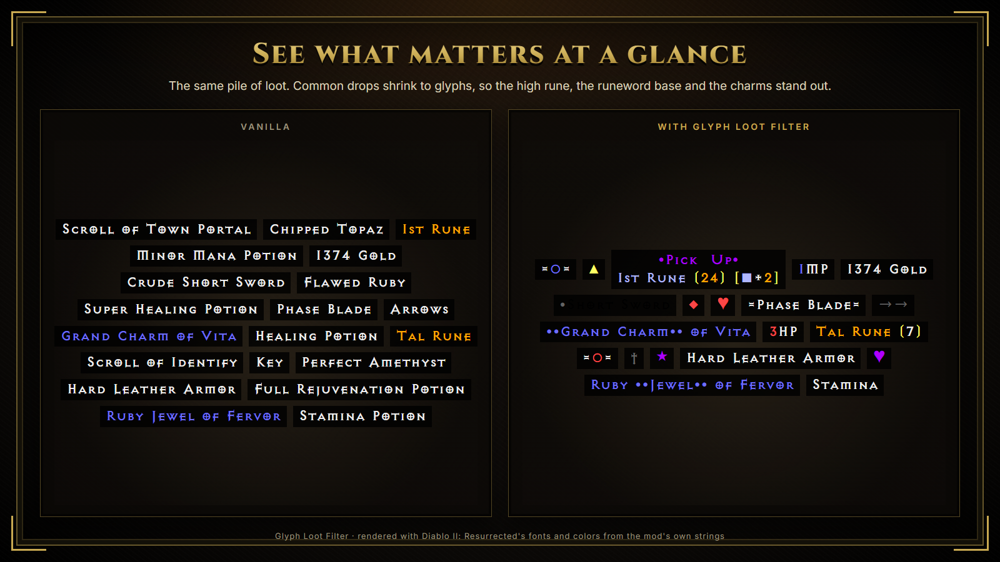
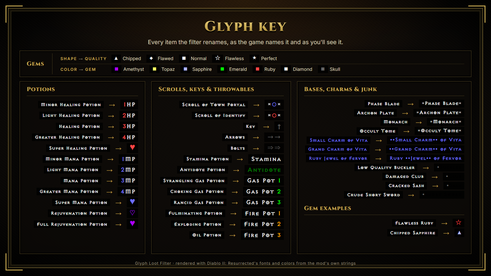
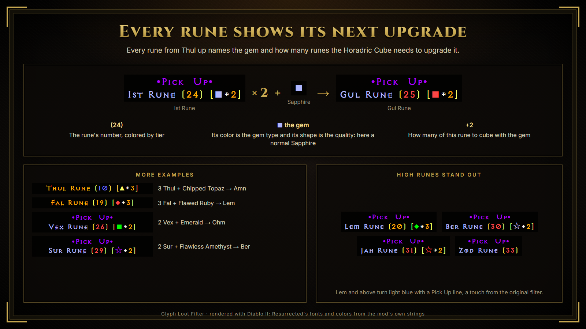
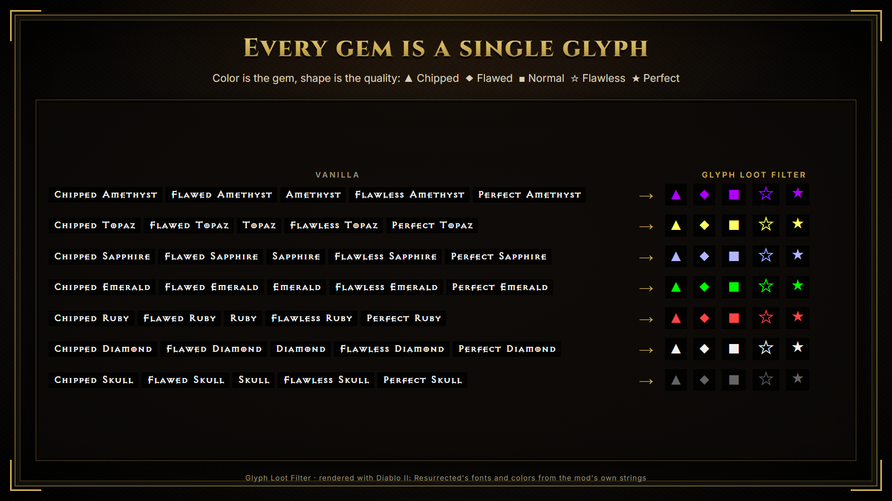
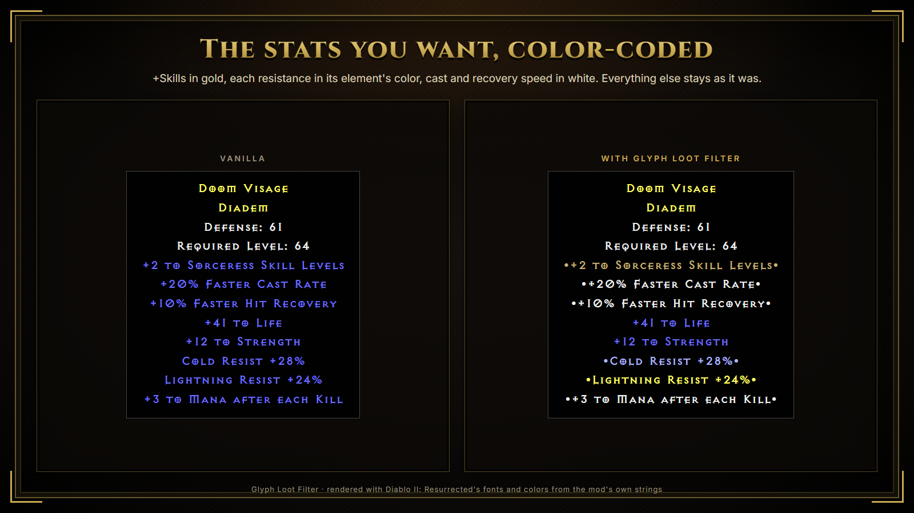

# Glyph Loot Filter

**A [D2RMM](https://github.com/olegbl/d2rmm) loot filter that turns gems, potions and scrolls into colored symbols and labels each rune with the cube recipe that upgrades it to the next one.**

Diablo II: Resurrected labels every drop with its full name, so a screen of loot turns
into a wall of text. This filter shortens the common drops to small colored glyphs
and makes the drops worth picking up easy to spot: high runes, runeword bases,
charms and jewels. It only changes item text, so it works with any other mod that
leaves the item string files alone.

## Download

1. Download `GlyphLootFilter.zip` from the
   [latest release](https://github.com/levinium/GlyphLootFilter/releases/latest).
2. Extract it into your D2RMM `mods` folder, so you end up with
   `D2RMM\mods\GlyphLootFilter\mod.js`.
3. In D2RMM, enable **Glyph Loot Filter** and click **Install Mods**.

You need [D2RMM](https://github.com/olegbl/d2rmm) to install it. If you used
D2R Simple Loot Filter before, disable it: both mods rename the same items.

The filter supports the English (enUS) text only.

## See what matters at a glance

Common drops shrink to glyphs, so the drops worth picking up stand out from the rest
of the pile.

## Glyph key

Every item the filter renames, from the game's own name to what you'll see on the ground.

## Every rune shows its next upgrade

Every rune from Thul up shows the gem and the number of runes the Horadric Cube needs
to upgrade it:

| Label | Meaning |
|---|---|
| `Ist Rune (24)` | The rune and its number, with the number colored by tier |
| `[■ + 2]` | Cube **2** Ist with a **normal Sapphire** (blue ■) to get the next rune (Gul) |

The gem glyph uses the gem's color and the same quality symbols as the gems
themselves, so you can read the recipe without looking it up. El through Ort need
no gem, so they show only their number.

### High runes stand out

Carried over from the original filter: Lem and every rune above it is drawn in light
blue with a purple **•Pick Up•** line above it, so a high rune is hard to miss
in a pile of loot.

## Gems at a glance

Each gem is a single symbol in its color. The shape gives the quality:

| Chipped | Flawed | Normal | Flawless | Perfect |
|:---:|:---:|:---:|:---:|:---:|
| ▲ | ◆ | ■ | ☆ | ★ |

Amethyst is purple, Topaz yellow, Sapphire light blue, Emerald green, Ruby red,
Diamond white and Skull gray. To use other symbols, edit `gemSymbolMapping` at the
top of `mod.js`; every gem and rune recipe picks up the change.

## Potions, scrolls and more

| Item | Shown as |
|---|---|
| Healing / Mana potions | `1HP` … `4HP`, `1MP` … `4MP` (number in red or blue); Super potions as a red or blue ♥ |
| Rejuvenation / Full Rejuvenation | purple ♡ / ♥ |
| Town Portal / Identify scroll | `=○=` in blue / red |
| Arrows / Bolts | gray `→→` / `⇒⇒` |
| Key | gray `†` |
| Throwing potions | `Fire Pot 1`, `Gas Pot 2` and so on |

## Runeword bases, charms and jewels

Elite bases that make good runewords are framed in equals signs, for example
`=Phase Blade=`, `=Archon Plate=` or `=Monarch=`. This covers class items too:
Assassin claws, Sorceress orbs, Amazon weapons, Druid pelts, Barbarian helms,
Paladin shields, Necromancer heads and Warlock books.

Small Charms, Grand Charms and Jewels are marked `••Grand Charm••`.

Low Quality, Damaged, Cracked and Crude items fade to a gray dot.

## Stats that matter

Important item stats are wrapped in dots and colored by type. +skills and all
resistances are gold; fire, cold, lightning and poison resistances are in their
element's color; FCR, FHR and run/walk speed are white; attack stats are dark red.

## Settings

Each part of the filter can be switched off in D2RMM:

| Setting | What it changes | File |
|---|---|---|
| Item names | Gem, potion, scroll, key and ammo symbols; base and charm highlights | `item-names.json` |
| Item stats | Stat colors | `item-modifiers.json` |
| Low quality items and normal gems | The gray dot, and normal Sapphire, Emerald, Ruby and Diamond | `item-nameaffixes.json` |
| Runes | Rune numbers, cube recipes and the Pick Up line | `item-runes.json` |

## Changes from D2R Simple Loot Filter

- Gems, skulls, potions, scrolls, keys and ammo are shown as glyphs instead of short names.
- Runes from Thul to Cham show their cube upgrade recipe.
- Normal-quality gems and all five Diamond grades are now covered.
- Elite Warlock books are highlighted as runeword bases.
- Hellspawn Skull is highlighted. The original renamed an unused string, so it never showed.
- Charms use the same `••` marker as jewels.
- `mod.js` has a full color and symbol reference, noting which symbols render in D2R.

## Credits and permissions

Glyph Loot Filter is based on
[D2R Simple Loot Filter](https://www.nexusmods.com/diablo2resurrected/mods/54) by
**Cbraqz**, and on its D2RMM version,
[D2R Simple Loot Filter (Warlock Update)](https://www.nexusmods.com/diablo2resurrected/mods/205),
by **kabobist**. Both authors allow modified versions to be shared as long as they
are credited. Thanks to **olegbl** for [D2RMM](https://github.com/olegbl/d2rmm).

You may share and modify this mod if you credit Cbraqz, kabobist and levinium.
Don't sell it or include it in anything sold.
